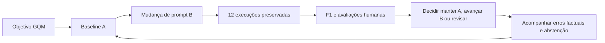

# Protocolo AV3 — registrado antes da bateria final

Preparação iniciada em 07/11/2026. Estado: implementado, referências aguardam revisão humana. Não reutilizar as notas humanas da AV2 como notas da AV3.

## Recorte e versões

Mesmo SmartScraperGraph 2.3.1, HTML sintético local, schema da AV2, Ollama e llama3.2:latest. A é o prompt P2 da AV2; B acrescenta orientações para citar a linha completa, tratar conflito e abster-se. O único fator experimental alterado é o **prompt**. São várias instruções dentro desse fator; o desenho não permite isolar o efeito de cada frase. B é candidata, não melhoria comprovada.

Não usar o adaptador de bloqueio da AV2: avaliar a saída do grafo, incluindo defeitos. As 16 respostas históricas não contam entre as 12 novas. CT01–CT04 são funcionais (catálogo comum, preço zero/decimal, preço ausente e preço conflitante); CT05 não contém catálogo; CT06 reformula CT01. A dupla CT01/CT06 é relacionada, não independente.

## GQM

**Objetivo:** avaliar se uma mudança no prompt melhora a adequação e a sustentação da extração de catálogo, sob a perspectiva da equipe avaliadora, comparando A/B nos mesmos seis casos sintéticos, e verificar a representatividade do sinal lexical.

| Pergunta | Medida e unidade | Fórmula e denominador | Limitação |
|---|---|---|---|
| Q1: B atende melhor à tarefa que A? | Aprovação humana, proporção e % por versão | Decisões finais aprovadas / 6; três notas 2 e nenhuma falha crítica | Uma resposta por condição; oito decisões com apenas R1 |
| Q2: o sinal automático representa adequação? | F1 lexical, [0,1], por saída e média por versão | P=comuns/tokens da resposta; R=comuns/tokens da referência; F1=2PR/(P+R); média=soma/6 | Similaridade lexical não verifica fatos; chaves JSON e nomes repetidos podem inflar o sinal |
| Q2, mesma pergunta | Concordância automático–humano, proporção e % | Decisões iguais / 12 | Concordar não demonstra validade geral, amostra pequena |

Diagnóstico adicional: concordância das decisões binárias R1–R2, **iguais/4 antes do consenso**. Diferenças em qualquer nota ou flag também exigem consenso documentado, mesmo se a decisão binária coincidir.

## Texto, tokenização e limiar fixados

Saída nativa JSON preservada. Para F1, serializar objeto com `json.dumps(ensure_ascii=False, sort_keys=True)` (mesma regra na referência); strings não são corrigidas. Assim todos os campos, inclusive fonte, trecho e motivo, entram na medida. Isso não é avaliação semântica. Aplicar NFC, `casefold`, regex Unicode `\w+` e interseção de multiconjuntos. Pontuação é ignorada: casas decimais se tornam tokens separados; registrar essa limitação. Sem sobreposição ou saída vazia/falha: F1=0. Referência sem tokens bloqueia a bateria.

**tau=0,5**, escolha didática permitida no enunciado, sem calibração ou ajuste após resultados. Sinal automático: F1 >= tau. Falhas do grafo/timeouts entram como resposta vazia para a métrica, preservando logs e qualquer geração parcial no bruto; não são descartadas e não geram nova tentativa automática.

## Rubrica humana e falha crítica

| Dimensão | 0 | 1 | 2 |
|---|---|---|---|
| Correção | Erro substantivo, produto/preço inventado ou saída inutilizável | Parcial/erro menor | Sem erro identificado ao conferir fonte e referência |
| Relevância | Não atende à extração | Atende parcialmente | Atende, inclusive abstenção correta |
| Suporte | Sem apoio na fonte | Apoio parcial ou trecho insuficiente | Afirmações sustentadas e trecho identificável, ou abstenção justificada |

Falha crítica=1 se inventar produto/preço, escolher preço vigente sem evidência em conflito, atribuir fonte inexistente ou não produzir saída utilizável (falha/vazia). Nos demais casos 0, sem dispensar a rubrica. Ausência de preço com produto existente pede `null`, não apagar produto. Sem catálogo: produtos vazios e motivo explicativo. Não exigir igualdade literal do motivo para nota humana. O trecho deve ligar nome ao preço; em conflito, registrar evidência do conflito, sem escolher um valor.

R1 avalia 12 saídas; R2 avalia CT01 e CT05 de A/B (quatro), sem consultar notas de R1. Pacotes separados ocultam versão e F1; quem executou ou leu resultados pode reconhecer variantes. Registrar exposição e outras limitações do cegamento. Não discutir antes de salvar as notas individuais. Para diferenças, preencher consenso separado com justificativa, preservando originais. Ausência de anotações = indisponível, nunca zero.

## Regra de decisão anterior à execução

Levar B à próxima etapa somente se tiver mais aprovações humanas que A, nenhuma falha crítica em B e nenhuma regressão aprovada-em-A/reprovada-em-B. Empate sem falhas críticas: manter A por não demonstrar ganho. Falha crítica em B ou regressão: revisar B; não avançar. Havendo falha crítica em A, manter A significa somente preservar baseline, não autorizar uso. Métrica automática sozinha nunca promove B. Com anotações incompletas, decisão pendente.

## Execução, preservação e acompanhamento

Ordem fixa: CT01 A/B, CT02 B/A, alternando até CT06. Uma execução por caso/versão, timeout 120 s por subprocesso, sem retentativa. Manifestos registram ambiente antes e depois, digest, configuração, código/commit, prompts, referências, rubrica, fontes e arquivos de saída. Digests/configuração precisam coincidir entre início e fim; se não, comparabilidade fica bloqueada. Temperatura zero não garante determinismo nem estabilidade. Tempo de aquecimento não é critério de decisão.

O modo `pilot` faz só CT01/A, separado e excluído dos resultados finais. Não ajustar tau a partir dele. O modo `final` exige seis referências revisadas por pessoa e preserva snapshot antes de chamar o modelo. Novas execuções usam novos diretórios; nunca corrigir evidências brutas manualmente. Rastreio: caso -> request/response -> ID cego -> notas -> consenso -> decisão -> versão.

Acompanhamento proposto: erros factuais e abstenções inadequadas em novos casos sintéticos, com revisão humana. Reverter selecionando `versions/A/prompt.md`, mantendo modelo/configuração e preservando os novos erros para análise. Não é implantação em produção.

## Execução completa provisória — 08/11/2026, antes das chamadas

A equipe solicitou executar as 12 combinações e análise por IA. Como a revisão humana das referências ainda não ocorreu, foi criado o modo `provisional`: executa os mesmos seis casos e A/B, registra a falta de revisão prévia e gera pacotes humanos em branco. Não representa conclusão acadêmica da bateria final exigida. Nenhuma regra de pontuação, tau, referência ou prompt foi alterada após resultados do piloto. A análise adicional será identificada como IA, sem substituir R1/R2. Uma revisão posterior não deve ser retrodatada; a equipe deverá decidir com o docente se aceita este lote ou se é necessária nova bateria após revisão.
